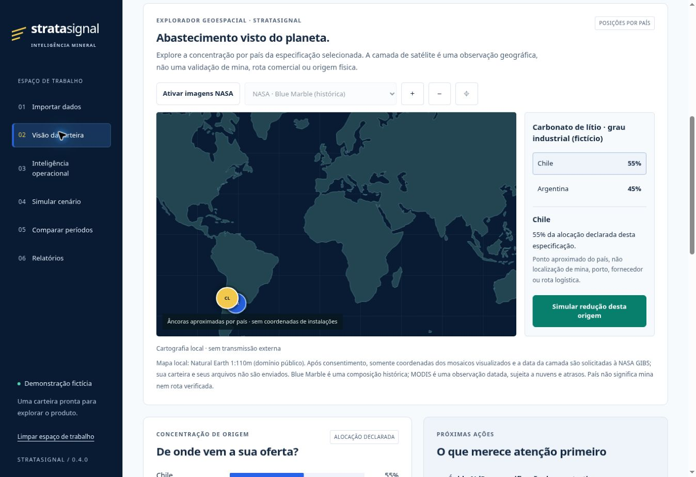

# StrataSignal — Critical Mineral Supply Assurance

**A working local MVP with a web workbench for a managed procurement-intelligence service.** Assess sourcing concentration, inventory exposure, documentary metadata and experimental delivery-delay estimates. Start with industrial graphite; extend to other materials only with a technically reviewed specification and suitable data.

**Status:** research-backed product hypothesis; functioning prototype; no paying customers, field validation, security certification or production SaaS claimed. The name is provisional.

[UX architecture and implementation backlog, in Portuguese](docs/UX_DESIGN_PT.md) · [Market research and business model, in Portuguese](docs/MARKET_RESEARCH_PT.md) · [Sample report](demo/report.html) · [Monthly comparison](demo/monthly/report.html) (download HTML and open locally) · [Methodology](docs/METHODOLOGY.md) · [Security](SECURITY.md) · [Verification](docs/VERIFICATION.md) · [Migration record](docs/MIGRATION.md)

**[Explore the public trade panorama and partner map](https://stratasignal.com.br/#mapa)** for official Brazilian trade statistics. The [fictional workbench](https://stratasignal.com.br/carteira/) uses synthetic procurement data. Private imports use the local workbench.

**[Explore global mineral markets](https://stratasignal.com.br/mercados/)** for country and territory trade profiles, mineral products and exchange lookups. The national iron ore series for Brazil and Australia remain available from that page.



## The service a customer receives

An analyst reviews a bounded procurement dataset and delivers a private HTML decision brief, JSON results, an integrity manifest and a prioritized verification queue. A monthly service can repeat that process with updated customer data. The software already performs the calculations; onboarding, technical review and interpretation are human services.

| Capability | Implemented behavior |
|---|---|
| Exposure analysis | Country and supplier HHI, declared allocations, stock coverage and nominal lead-time comparison, separately for each specification |
| Metadata triage | Missing evidence, origin disagreement, inconsistent dates, expiration and identical fingerprints across suppliers |
| Conditional scenarios | Change affected country, supply reduction and duration; calculate uncovered demand and stock depletion |
| Period comparison | Same-portfolio snapshots: concentration, stock coverage, supplier allocations and new/disappearing documentary signals; specification changes suspend deltas |
| Machine learning | Regularized logistic regression for order lateness; chronological holdout, matured labels, baseline comparison and abstention |
| Temporal stability | Three additional chronological windows; predictions require at least two valid windows and improvement over their baselines in at least two thirds |
| Operational intelligence | Descriptive delivery rates and Wilson intervals, completed-delivery P90, overdue orders, cost-based origin dependencies and a bounded stress matrix |
| Public-data preparation | Streaming importer for the MDIC's documented local CSV layout, with explicit NCM, flow and period |
| Public trade panorama | Publication-time Comex Stat snapshot for graphite and lithium carbonates. The partner map and keyboard-accessible table share the trade filters, with an independent publication month for curated news and a JSON report with both periods and sources. |
| Mineral markets | CEPII BACI trade profiles for 250 countries and areas and 185 HS product cuts, with exports, imports, volume coverage, ranking and yearly tables. The exchange directory and optional TradingView symbol lookup have separate coverage. |
| Public news context | Curated Canadian lithium news and Brazilian mineral policy context for graphite, filtered by mineral, publication month and country and exported with per-source provenance |
| Local workbench | Import JSON or map operational CSV columns; review inputs, run analysis, simulate, compare periods and download reports |
| Geospatial explorer | Globe and flat map with country allocations, optional dated NASA imagery in both projections, synchronized comparisons, and a shortcut to the supply shock simulator |
| Private delivery | Local analysis; loopback-only UI connection; no remote customer-data service, telemetry, external fonts or third-party AI calls |

The demo has **3 fictional material specifications, 6 fictional supplier positions and 780 synthetic orders**. Every report records whether its input is synthetic or customer-declared. Synthetic model metrics demonstrate software behavior only.

Version **0.4** supports **100 material specifications, 500 supplier positions, 20,000 orders and 5,000 evidence records**, within a 16 MiB normalized input. Indexed aggregation avoids repeatedly scanning the entire history. A [measured synthetic capacity run](docs/benchmarks/v0.4-linux.json) exercised all four limits: about 1.63 seconds for deterministic analysis and descriptive intelligence in the recorded environment, without ML. This is a local workload observation, not a multi-user throughput or service-level claim.

Browser analyses run in a separate process with cancellation, a 90-second wall deadline and, on supported POSIX systems, 60 CPU seconds and a 2 GiB address-space limit. The interface remains available while the worker computes. [Architecture, bounds and threat model](docs/ARCHITECTURE.md).

## Painel local

After installation, open the browser workbench:

```bash
python -m stratasignal serve
```

The command opens an address on `127.0.0.1`, with a temporary access credential in its fragment. Keep that complete address private; it expires after eight hours, requiring a restart. Use `--no-open` to open the printed address manually or `--port 8766` to choose another local port. The server binds only to IPv4 loopback and is intended for one operator on a trusted machine.

1. Choose the built-in fictional portfolio, import a raw procurement JSON bundle, or select **Planilhas CSV** and map your columns.
2. For CSV, explicitly choose the separator, numeric format, date format and whether supplier participation is a fraction or percentage. Supply positions; order and evidence manifests are optional. See [the CSV guide and fictional samples](docs/CSV_IMPORT_PT.md).
3. Review the portfolio and run the analysis. Explore country exposure in the **satellite atlas**, the documentary queue and experimental delivery estimates when the optional ML dependency is installed. The globe and flat map include local land outlines. Clicking **Ativar imagens NASA** requests dated imagery from NASA GIBS. [Geospatial scope, image dates and privacy](docs/GEO_SPATIAL_PT.md).
4. Calculate a supply-reduction scenario. Downloads include the **last calculated** scenario, rather than unsent slider changes.
5. Export HTML, JSON results and the normalized current input. For the next period, import that normalized input as the previous baseline under **Comparar períodos**.

**Inteligência operacional** adds a searchable, paginated delivery-history table and 30/60/90-day country stress cases at 25/50/100% supply reductions. **Usar premissas** fills the simulator; click **Calcular cenário** to update the result. The grid covers up to 12 origins selected by declared monthly reference cost and discloses omitted origins. Scenarios describe separate conditional assumptions and must not be added together. Wilson intervals describe observed rates under binomial assumptions; P90 excludes open orders and requires ten completed deliveries. They are not new operational forecasts.

Uploaded content stays in the local Python process memory. Closing the process clears its state; it does not automatically save your inputs or results. Downloads use your browser's normal download handling. Use approved local storage and sharing practices. The interface has no browser storage or telemetry. The optional imagery layer contacts NASA GIBS only after an explicit user action; the visual tiles do not convey procurement records.

The online fictional workbench contains only repository-owned fictional data. Private-file import is disabled and model results are precomputed on the synthetic fixture. Public trade statistics have their own page and snapshot. The local workbench's Comex CSV context and document digest remain available through the CLI.

## Run the demo

Python 3.11+ is required. Deterministic analytics use the standard library; ML is optional.

```bash
git clone https://github.com/WellingtonMax/stratasignal.git
cd stratasignal
python -m venv .venv
source .venv/bin/activate
python -m pip install -e '.[ml]'
mkdir -p reports
python -m stratasignal demo --out reports/demo-001
```

Open `reports/demo-001/report.html`. It works offline. Navigate between overview, scenarios, evidence and model/provenance. Export JSON from the report. Existing output directories are deliberately refused; use a new run identifier.

To demonstrate the monthly comparison with two explicitly synthetic snapshots:

```bash
python -m stratasignal demo --with-comparison --out reports/monthly-demo-001
```

The **Evolução** section shows changes between the two dates. Both synthetic input files are saved in the output directory for inspection.

Without third-party dependencies:

```bash
python -m stratasignal demo --out reports/rules-001 --without-ml
```

## Analyze customer data

Keep customer inputs in the ignored `client-data/` directory. Never commit them. [examples/minimal-client.json](examples/minimal-client.json) is a placeholder schema illustration, **not actual customer data**. Replace all values and keep `dataset_kind` set to `client` for real records. An empty order history is supported; the model abstains.

```bash
python -m stratasignal analyze \
  --input client-data/procurement.private.json \
  --out reports/customer-001 \
  --shock-country CN --shock-days 45 --reduction 0.5
```

Generate the full synthetic input for schema exploration with `python -m stratasignal sample --out sample.synthetic.json`. For each material, demand, stock and name must match across supplier rows and allocation shares must sum to one. Quantities are kilograms and cost is USD/kg. Technical grades, product forms and origin definitions must be reviewed before grouping records. `ZZ` explicitly denotes an unknown origin; two-letter country codes are operator-supplied and not independently verified against an ISO registry.

The schema rejects unknown fields, duplicate IDs, orphan records, unsupported dates, non-finite values, invisible/directional control characters and inconsistent allocations. Limits: 16 MiB per input and normalized bundle, 100 materials, 500 positions, 20,000 orders and 5,000 documentary records. The local HTTP body limit is 64 MiB, including encoding overhead.

## Compare reporting periods

Use two raw procurement input bundles, not generated report files. Give both a stable, pseudonymous `portfolio_id` for the same customer/portfolio and preserve material/supplier/evidence identifiers across periods. The earlier `as_of` must precede the current one; data kinds must match. Inputs without a portfolio identifier remain supported for a single analysis.

```bash
python -m stratasignal compare \
  --previous client-data/previous.private.json \
  --current client-data/current.private.json \
  --out reports/monthly-001 --without-ml
```

Both snapshots are recalculated with the same deterministic rule version. The current report gains a comparison section and its manifest records both input hashes. Renamed specifications, additions and removals are shown separately without fabricated deltas. A disappearing metadata signal is not evidence of verified remediation. `portfolio_id` is an operator declaration, not customer authentication. The comparison does not claim causal effects, model improvement or financial savings.

## Public data and file metadata

Download the documented NCM-level CSV from the [official MDIC page](https://www.gov.br/mdic/pt-br/assuntos/comercio-exterior/estatisticas/base-de-dados-bruta). Choose and verify an NCM for the product form and classification year; the software does not infer chemistry or purity from it. Example command syntax:

```bash
python -m stratasignal import-comex \
  --input client-data/IMP_2026.csv --flow import \
  --ncm 25041000 --from 2026-01 --to 2026-09 \
  --out client-data/comex.private.json
python -m stratasignal analyze \
  --input client-data/procurement.private.json \
  --market client-data/comex.private.json \
  --out reports/customer-context-001
python -m stratasignal digest \
  --input client-data/document.pdf \
  --out client-data/document-metadata.private.json
```

The CLI importer expects an annual raw NCM CSV with semicolon delimiters. It aggregates repeated state, route and customs-office rows by month and MDIC country code and makes no network requests. The separate public panorama queries the official Comex Stat API when a publication is prepared. The [public-data contract](docs/DEVELOPMENT.md#build-the-public-trade-panorama) describes coverage, source dates and refresh behavior.

`digest` hashes the original bytes and records size and filesystem modification time. It does not extract PDF content/XMP, execute documents, perform OCR, validate signatures, verify certificates or authenticate a physical shipment. Documentary dates and origins in the input manifest are declarations.

## Verification

```bash
python -m unittest discover -s tests -v
python -S -m unittest discover -s tests -v
```

The second command exercises the standard-library path and skips ML-dependent tests. `npm ci --ignore-scripts && npm test` runs report, workbench and public panorama DOM interaction checks. See [the verification record](docs/VERIFICATION.md) for exact observed results and environment limitations. Dedicated workflows run rule, ML, UI interaction, installed-package, dependency-advisory and CodeQL checks. GitHub Actions are pinned by commit SHA and checkout credentials are not persisted.

To repeat the capacity measurement into a new output file:

```bash
python -m stratasignal benchmark --out reports/capacity-001.json
```

## Commercial boundary

Sell a narrow diagnostic plus reviewed periodic reporting before building a shared cloud service. Customer interviews, access to a real historical dataset, domain review, prospective evaluation and a paid pilot remain necessary. SaaS authentication, tenant isolation, document storage, regulatory certification, real-time event feeds, calibrated operational forecasts and automatic supplier qualification are not implemented.

AI-assisted original development. No client project, testimonial, savings estimate or predictive result is fabricated. No license for the product code is granted by this README; obtain a commercialization/license decision before distributing to third parties. Third-party package and data rights remain with their respective licensors.
