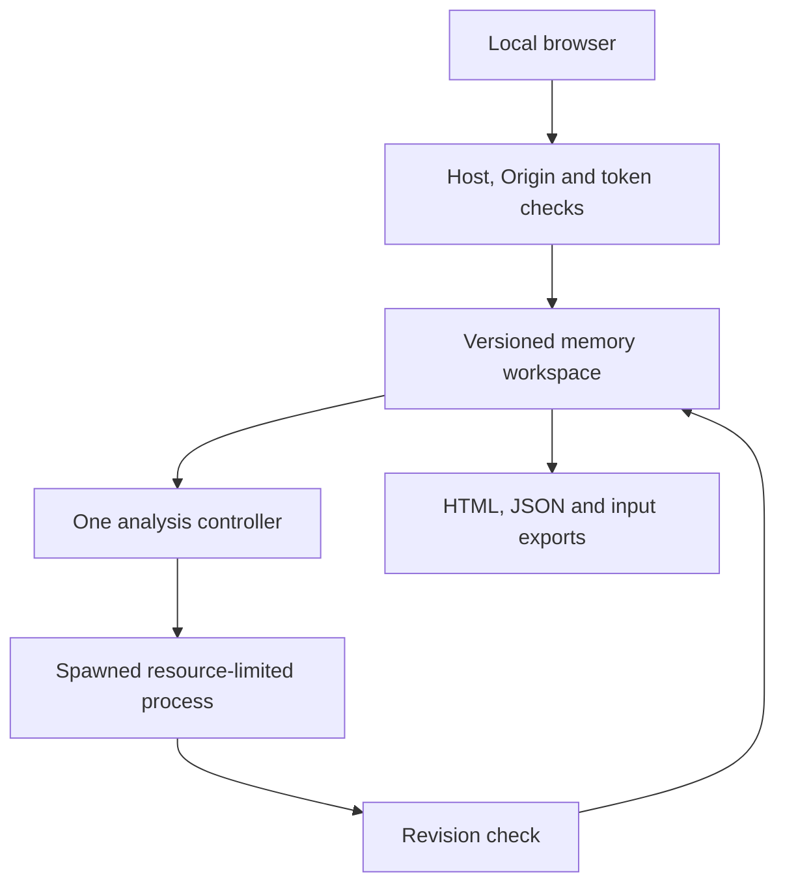

# StrataSignal 0.4 architecture

The workbench supports one trusted local operator. Its data and compute bounds are distinct from a future shared cloud service. The static Site separates public aggregate data from the synthetic-only workbench. See [ADR 0001 on publication and the private boundary](adr/0001-publicacao-e-fronteira-privada.md).

The proposed shared data model for the public observatory and future services is documented in [ADR 0002 on mineral data architecture](adr/0002-arquitetura-dos-dados-minerais.md).

## Admission and lifecycle

The HTTP service binds only to `127.0.0.1`. Up to eight connections and two body-processing operations are admitted; job computation uses a separate spawned process. A single job is accepted, without an unbounded queue. `POST /api/analyze` returns `202` and a random job ID; authenticated `GET /api/jobs/<id>` retrieves state/result. `POST /api/cancel` requests cancellation. The browser polls while keeping its cancel control usable.

Input import is validated before publication. A successful replacement increments workspace revision, clears stale results/baselines and cancels running work. A worker receives its own snapshot. Its result commits only if that revision still matches; reset cannot be undone by a late worker response. A bounded JSON channel carries results. Error messages omit private data. The controller reaps completed, cancelled, failed and timed-out processes.

The worker has a 90-second wall budget. Supported POSIX limits additionally cap CPU at 60 seconds, address space at 2 GiB, descriptors at 64 and core dumps at zero. Windows' equivalent CPU/memory enforcement is not implemented. Resource isolation does not confine the trusted worker's filesystem or network access; untrusted executable plugins and external serialized models are not accepted.

## Analytical scale

| Dimension | Previous limit | 0.4 limit |
|---|---:|---:|
| Materials | 20 | 100 |
| Material/supplier positions | 64 | 500 |
| Orders | 3,000 | 20,000 |
| Evidence rows | 500 | 5,000 |
| File and normalized input | 4 MiB | 16 MiB |

Indexed aggregation replaces repeated whole-history scans. Temporal feature construction remains ordered by date with a heap of outcomes as they become observable. The descriptive stress grid has at most 108 cells; supplier history renders 20 rows per page and documentary signals render in batches. Limits remain active rather than relying on available RAM.

The recorded [synthetic capacity measurement](benchmarks/v0.4-linux.json) processed all four record limits in 1.6256 seconds, with 39,040,538 peak traced Python allocation bytes during analysis. It used Python 3.12.14 on Linux, deterministic rules plus descriptive intelligence, and no ML. Input was 6,728,681 bytes. `tracemalloc` changes timing and does not measure total process RSS; this is one reproducible local workload observation, not throughput, a percentile latency or a promised SLA.

## Shared service boundary

A production shared offering still needs authenticated tenant identities, server-enforced ownership, separate durable job/result storage, encrypted data lifecycle, OS/container isolation, per-tenant quotas, audit/incident handling and deployment-specific verification. The existing public demo accepts no customer data. Increasing local input capacity does not establish those cloud boundaries.
