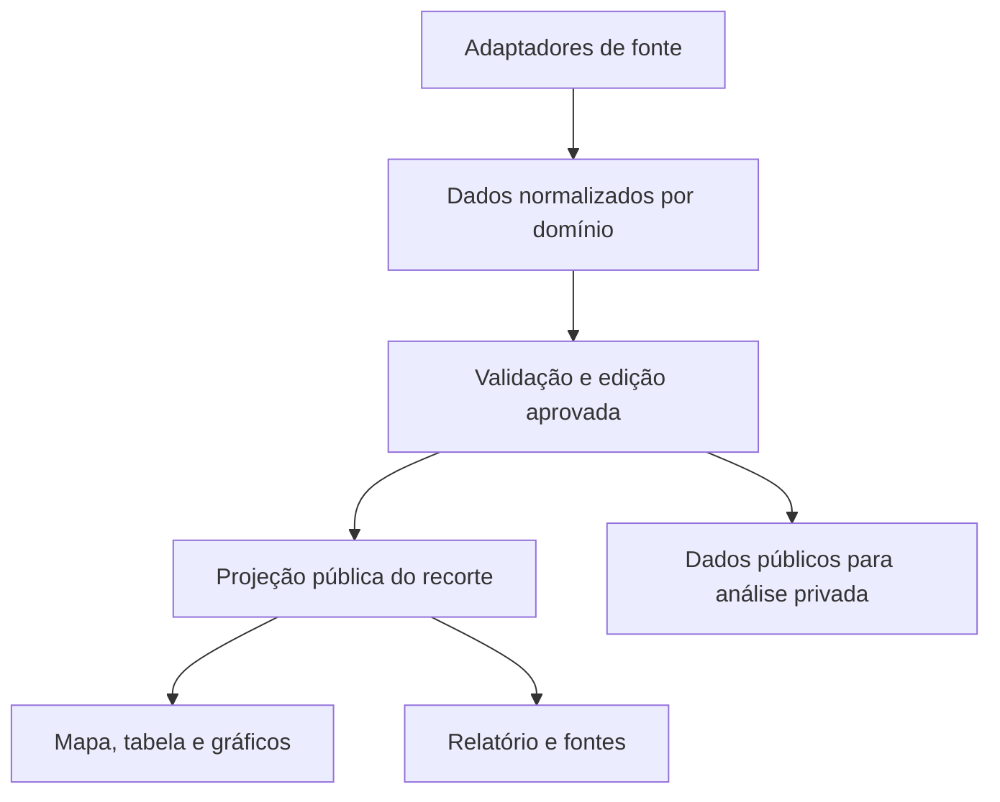

# ADR 0002 Arquitetura dos dados minerais

10 de novembro de 2026 · Proposta para revisão · Complementa a [ADR 0001](0001-publicacao-e-fronteira-privada.md).

## Ponto de partida

O [publicador Python](../../stratasignal/build_public_site.py) já empacota edições do Comex Stat por SHA-256. [Mercados](../../stratasignal/public_markets_world.py) prepara o catálogo anual BACI por outro caminho. O [PR #22](https://github.com/WellingtonMax/stratasignal/pull/22), no commit `6fd3a47acd26`, acrescenta 27 cortes anuais do Comex Stat e a ficha logística de Carajás. A ficha ainda é curada diretamente em JavaScript nessa revisão. O pacote público lido para este estudo declara esse mesmo commit de origem. Esses três caminhos precisam de contratos comuns para que um novo país ou produto entre pela camada de dados e chegue, com a mesma procedência, a cada tela.

## Referências inspecionadas

Os links abaixo apontam para as revisões lidas. A aplicação proposta usa os padrões observados. A eventual adoção de código, uso de serviço e redistribuição de dados dependem de decisões de direitos separadas.

| Repositório | O que encontramos no código | Aplicação no StrataSignal |
| --- | --- | --- |
| Critical Materials Atlas | O `runner.py` calcula dependências e impressões digitais. A auditoria encontrou versões antigas de um indicador de germânio em duas saídas. O modelo comercial distingue fonte, estágio, unidade e classificação. [Auditoria de arquitetura](https://github.com/materials-atlas/critical-materials-atlas/blob/3ed80b585f7624d1b92d9d77d5f8f609d0a37195/ARCHITECTURE.md#2-three-proven-failures-one-latent) · [Montagem do cubo](https://github.com/materials-atlas/critical-materials-atlas/blob/3ed80b585f7624d1b92d9d77d5f8f609d0a37195/build_cube.py) | Um adaptador por fonte e um contrato normalizado por domínio. Mapa, gráficos e relatório leem projeções da mesma edição. CI reproduz os resultados a partir de entradas congeladas. |
| Base dos Dados | O pipeline Comex trata arquivos do ano inteiro. A validação confere linhas, FOB, peso e quantidade estatística com o arquivo de conferência do MDIC. O staging usa partições de nome fixo. [Documentação do conjunto](https://github.com/basedosdados/pipelines/blob/d2dad9b2468d59ac82964f0119ae20c420abf47a/pipelines/datasets/br_me_comex_stat/README.md) · [Validação](https://github.com/basedosdados/pipelines/blob/d2dad9b2468d59ac82964f0119ae20c420abf47a/pipelines/datasets/br_me_comex_stat/utils.py#L130) | Revalidar a partição afetada inteira. Para o CSV completo, conferir os totais oficiais antes de publicar. Guardar ambas as versões em caso de revisão retroativa. |
| Global Energy Monitor | A auditoria separa identidade da planta e da unidade e distingue o ano da observação da data da edição. A comparação de campos identifica candidatos a harmonização. [IDs](https://github.com/GlobalEnergyMonitor/gem-tracker-metadata-audit/blob/39aee11e81afd7b332c5740d12b8097f1ad09d81/docs/iop-01-ids.md) · [Datas](https://github.com/GlobalEnergyMonitor/gem-tracker-metadata-audit/blob/39aee11e81afd7b332c5740d12b8097f1ad09d81/docs/std-13-temporal-snapshots.md) | Dar identidade própria à instalação e à unidade quando a fonte permitir. Registrar operador, proprietário e vigência em vínculos separados. Preservar a procedência no nível do vínculo. |
| Datawheel | O cliente OLAP separa dimensões, hierarquias e medidas. [Classe `Cube`](https://github.com/Datawheel/olap-client/blob/081dda335e6696f6eb136b2c1fe7756470e4d55b/src/cube.ts) | Compartilhar filtros tipados e definições de métricas entre as telas. Começar com projeções das edições e consultas SQL delimitadas. |
| Kpler | A estação recebe e decodifica mensagens AIS, reduz a frequência e as encaminha ao MarineTraffic. [Código de encaminhamento](https://github.com/kpler/iot-balena-ais-station/blob/f06f1435393938659a42ad0325cbeca77113def5/broadcast/src/index.ts) | Modelar posição de embarcação como evento logístico, com tempo e fonte. O vínculo entre navio, carga e comprador tem evidência própria. |
| Kensho / S&P Global | O plugin configura um adaptador MCP e suas fichas dependem de acesso aos dados da S&P. [Configuração](https://github.com/kensho-technologies/spglobal-agent-skills/blob/1d7d364a07d755d401b6f66d41affe71bc62a9b9/plugins/spglobal-plugin/.mcp.json) · [Requisitos](https://github.com/kensho-technologies/spglobal-agent-skills/blob/1d7d364a07d755d401b6f66d41affe71bc62a9b9/README.md) | Tratar cotações como integração substituível e condicionar acesso e exibição aos direitos da fonte. A análise de empresas começa por vínculos documentados entre emitentes e atividades. |

A [Altana](https://altana.ai/platform) serve de referência de produto para navegar dependências por empresa e material. A inspeção técnica acima está circunscrita ao código público verificável.

## Decisão proposta

Manter o monólito modular Python e o publicador estático. Separar quatro responsabilidades no código, reutilizando os adaptadores e validadores existentes.

**Entrada.** Registrar fonte, recorte, referência do provedor, momento da coleta, hash e política de uso. Reter bytes originais quando permitido. A identidade de uma carga candidata combina fonte, partição, hash do conteúdo e versão da normalização. O horário da coleta fica na trilha de execução. Quando a fonte corrige valores com a mesma data editorial, os novos bytes identificam outra revisão.

**Dados.** Cada observação tem grão, unidade, período e fonte definidos no contrato. Cada projeção declara a edição, a cobertura e as definições que usou. A mesma função de projeção alimenta o mapa, as tabelas e o relatório. Os adaptadores são o ponto de contato com o formato de cada fonte.

| Domínio | Contrato inicial |
| --- | --- |
| Comércio | Comex mensal por NCM de oito dígitos, Brasil, fluxo e país parceiro, em USD FOB e kg líquidos. BACI anual por edição de SH, exportador e importador, com base monetária e unidade explícitas. Manter os dois conjuntos lado a lado. Comparações exigem períodos, produtos, unidades e bases compatíveis. Zero registrado, ausência e supressão são estados distintos. |
| Catálogo | Distinguir material, forma comercial e código aduaneiro. Registrar sistema, revisão, código original e vigência. Concordâncias NCM–SH são versionadas, podem ter vários destinos e carregam evidência. Um código agrupado mantém seu rótulo e sua medida no nível do grupo. |
| Indústria e logística | Instalação, unidade e organização têm IDs próprios. Um processo admite várias entradas e saídas, com papel explícito de produto principal, subproduto ou insumo reciclado. Operação, propriedade, capacidade, produção e ligação logística são relações ou observações próprias, com período e fonte. |
| Evidência | Cada afirmação sobre um vínculo tem fonte, referência a página/tabela/registro, escopo e estado editorial. Registrar separadamente quando a afirmação vale no mundo e quando entrou na edição, com precisão de data declarada. Identificadores oficiais e curadoria sustentam a fusão de entidades. Correspondências ambíguas ficam para revisão. |
| Mercados e regulação | Ligar emitente e instrumento pela identidade e vigência da listagem. Preservar bolsa, moeda, ajuste e fonte de cada série. Vincular atos ao órgão, jurisdição, escopo e vigência. Participação exige denominador do mesmo produto, etapa, território e período. Análises entre séries declaram método, janela e cobertura. |

**Publicação.** Validar esquema, chaves, totais e permissões antes de gerar um manifesto imutável de edições, versões de transformação e dependências. Manter permissões de armazenamento, processamento e redistribuição por fonte. Promover a edição inteira depois de verificar seus arquivos. Relatórios registram o identificador do manifesto e o recorte. Cada correção gera projeções novas. A recuperação aponta para a última edição aprovada e confere seus hashes.

**Serviço quando houver necessidade de estado.** O público continua com arquivos estáticos e projeções segmentadas por consulta. Para consultas dinâmicas e o serviço privado previsto na diretiva, usar FastAPI e PostgreSQL com migrações, com API e trabalhadores como processos distintos no mesmo repositório. Relações industriais ficam em tabelas com índices de adjacência. Percursos relacionais começam com consultas recursivas limitadas por profundidade e com detecção de ciclos. PostGIS entra com a primeira consulta espacial que exija índice, e Parquet entra quando volume, duração ou custo de leitura justifiquem. A análise privada consome edições públicas aprovadas por um caminho de leitura. Os dados do cliente seguem pela fronteira da [ADR 0001](0001-publicacao-e-fronteira-privada.md), com isolamento por organização como condição para o serviço compartilhado.

## Prova local

Um protótipo descartável em Python e SQLite usou o validador atual e o pacote do commit `6fd3a47acd26`. Conferiu o hash das 27 partições anuais do Comex, de janeiro de 2000 a outubro de 2026. Reprocessou as **11.623 observações** três vezes e preservou o total e as chaves. As **122 linhas** da janela recente conferiram com o recorte correspondente no arquivo anual de 2026.

A prova aplicou uma correção sintética de US$ 1 com a mesma data editorial. O identificador mudou, as duas edições foram consultáveis e a tentativa de promover um identificador inválido preservou a edição vigente. A reversão reproduziu as linhas originais. O mesmo protótipo representou um processo de refino com entrada de bauxita e saídas distintas de alumina e gálio, este com papel de subproduto. A prova exercitou a semântica local de edições e processos. Desempenho, concorrência e implantação em PostgreSQL ficam para as validações da camada de serviço. [USGS · Gálio](https://pubs.usgs.gov/periodicals/mcs2026/mcs2026-gallium.pdf)

## Primeiras entregas e aceite

A execução atual prioriza o gálio em quatro rodadas. A [ficha de evidências](../GALIO_SEMICONDUTORES_PT.md) e o [contrato de publicação](../DEVELOPMENT.md#atualização-de-mercados-globais) entregam as duas primeiras. As próximas rodadas conectam Mercados e o JSON à mesma edição e conferem a publicação, conforme o [backlog de UX](../UX_DESIGN_PT.md). Os recortes abaixo conservam seus critérios de aceite e servem de referência para a migração e as verificações de regressão.

1. **Brasil e grafita.** Extrair o contrato do caminho Comex existente e versionar a classificação do NCM 25041000 pela referência oficial e sua vigência. Usar duas edições retidas. Validar que o mesmo recorte entrega os mesmos valores, unidades e procedência no mapa, na tabela e no JSON. Testar carga duplicada, correção de mês antigo, zero observado, ausência, rejeição de carga e reversão. Conferir também o link com o recorte anual HS 250410 do BACI, com as duas coberturas explícitas. [MDIC · Dados abertos e tabelas](https://www.gov.br/mdic/pt-br/assuntos/comercio-exterior/estatisticas/base-de-dados-bruta) · [Procedimento do publicador](../DEVELOPMENT.md#build-the-public-trade-panorama)
2. **Ferro brasileiro.** Transferir a ficha de Carajás para o contrato de instalações, vínculos e evidências. Ler a mesma edição em Mercados e no JSON. Expor separadamente a rota declarada da mina ao terminal, o total comercial Brasil–parceiro e o emitente na bolsa. A promoção de uma ligação a um comprador ou a um embarque depende de uma fonte que identifique as partes ou a carga. [Vale · Logística](https://vale.com/pt/logistica)
3. **Semicondutores, começando pelo gálio.** Aplicar o mesmo contrato ao refino de bauxita com recuperação de gálio e às aplicações documentadas em semicondutores. A saída de gálio depende de etapa de recuperação. Quando a fonte comercial classificar gálio e germânio no mesmo grupo, a tela e o JSON exibem o total do grupo. Aceite é conseguir acrescentar o processo e as referências como dados. [USGS · Gálio](https://pubs.usgs.gov/periodicals/mcs2026/mcs2026-gallium.pdf) · [OMD · SH 2022, capítulo 81](https://www.wcoomd.org/-/media/wco/public/global/pdf/topics/nomenclature/instruments-and-tools/hs-nomenclature-2022/2022/1581_2022e.pdf?la=en)

Os três recortes entram pela mesma infraestrutura. A grafita valida a migração com uma jornada existente. Ferro e gálio exercitam os dois demonstradores do produto com topologias industriais diferentes.
